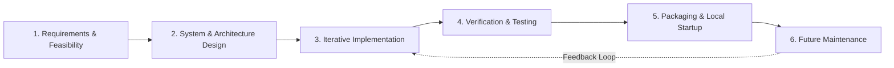
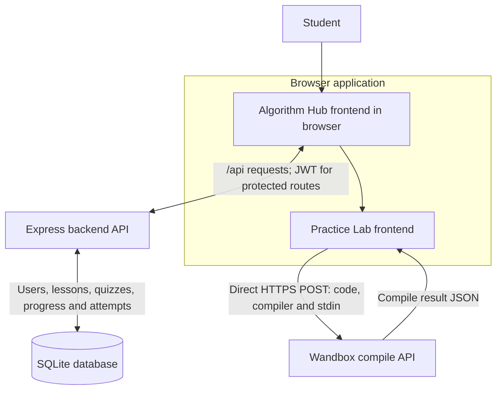
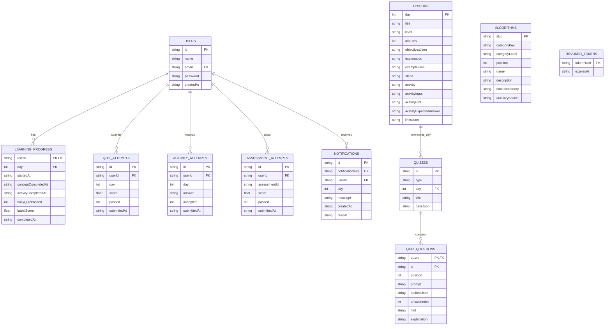
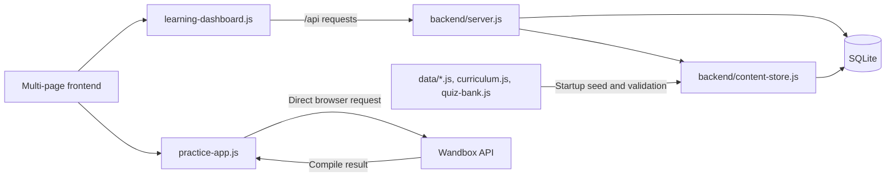
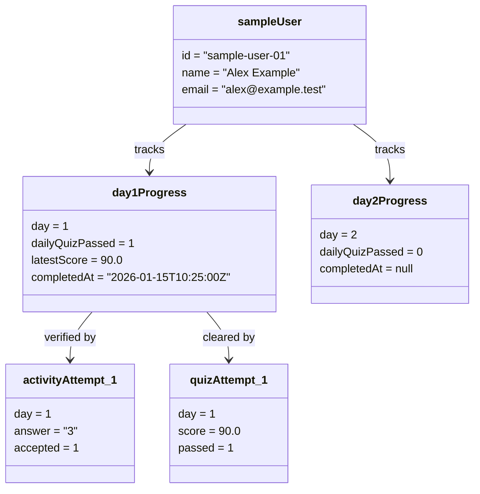
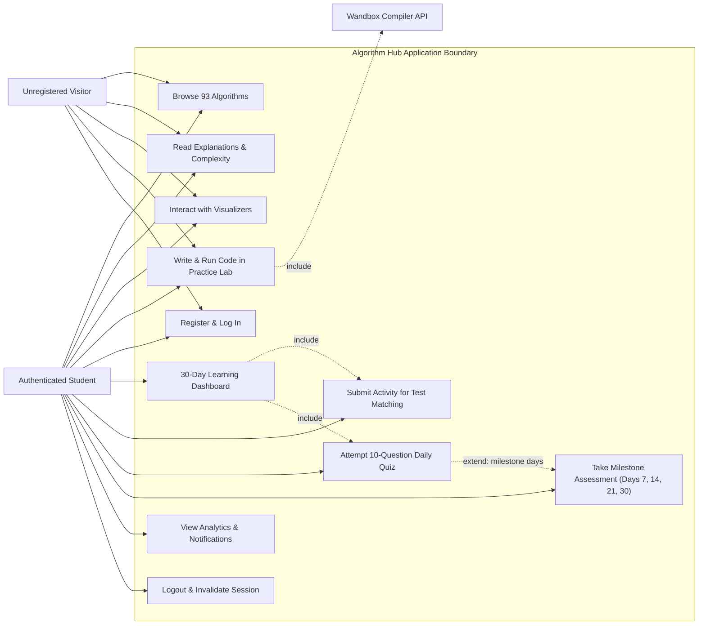

# ALGORITHM HUB
## INTERACTIVE ALGORITHM LEARNING AND VISUALIZATION PLATFORM

**A Project Report Submitted to**
**K.M.S.P. MANDAL’S**
**SANT RAWOOL MAHARAJ MAHAVIDYALAYA, KUDAL**
*(NAAC Re-Accreditation “B+” Grade)*

In partial fulfillment of the requirements for the Degree of
**Bachelor of Science in Computer Science (Semester V)**

**Designed By:**
**Mr. Piyush Uttam Sawant**
Seat Number: ________________________

**Under the Guidance of:**
* Asst. Prof. Santosh Chougule (M.C.A.)
* Asst. Prof. Prakash Talankar (M.C.A.)

**Through:**
THE HEAD, DEPARTMENT OF COMPUTER SCIENCE,
S.R.M. COLLEGE, KUDAL.
**UNIVERSITY OF MUMBAI**
Academic Year: 2026 – 2027

---

# DECLARATION

To,  
The Head of Department,  
Department of Computer Science,  
S. R. M. College, Kudal.  

Respected Sir/Madam,  

I undersigned, hereby declare that the project entitled **“Algorithm Hub – Interactive Algorithm Learning and Visualization Platform”** is developed under the guidance of our project guides. The system designs, database structures, source code implementations, and project findings presented in this report are based on original work developed by me.

I declare that this is my original work and that I have not copied project materials from unauthorized sources. I understand that any violation of academic integrity guidelines subjects me to applicable university rules.

**DATE:** ________________________  
**PLACE:** KUDAL  

___________________________________  
**(Mr. Piyush Uttam Sawant)**  
B.Sc. Computer Science (Semester V)

---

# CERTIFICATE

**K.M.S.P. MANDAL’S**  
**SANT RAWOOL MAHARAJ MAHAVIDYALAYA, KUDAL**  
*(NAAC Re-Accreditation “B+” Grade)*  

This is to certify that **Mr. Piyush Uttam Sawant** having Examination Seat Number ________________________ has satisfactorily carried out and completed his project work entitled:

### **“ALGORITHM HUB”**
**INTERACTIVE ALGORITHM LEARNING AND VISUALIZATION PLATFORM**

as prescribed by the **University of Mumbai** for the partial fulfillment of the degree of **Bachelor of Science in Computer Science (Semester V)** during the academic year **2026 – 2027**. The work done is satisfactory and is presented as per the prescribed specifications.

 

| | | |
| :---: | :---: | :---: |
| ____________________ | ____________________ | ____________________ |
| **Project Guide** | **External Examiner** | **Head of Department** |

 

**DATE:** ________________________  
**SEAL OF COLLEGE:**

---

# ACKNOWLEDGEMENT

It is my great privilege and pleasure to present this final project report on **“Algorithm Hub – Interactive Algorithm Learning and Visualization Platform”**. I express my sincere thanks to all the respected professors, mentors, and peers who guided me throughout the conceptualization, implementation, and documentation phases of this project.

I express my heartfelt gratitude to our respected **Principal** and the **Head of the Department of Computer Science**, S.R.M. College, Kudal, for providing modern laboratory facilities, uninterrupted computing infrastructure, and encouragement.

I would like to extend my deepest appreciation to our Project Guides, **Asst. Prof. Santosh Chougule (M.C.A.)** and **Asst. Prof. Prakash Talankar (M.C.A.)**, for their technical guidance, architectural suggestions, and constructive feedback during the development of Algorithm Hub, including algorithm visualization modules, database schema design, backend API development, and learning-dashboard functionality.

Finally, I thank my parents, family, and classmates for their constant moral support, patience, and motivation.

**Thank You.**  
**Mr. Piyush Uttam Sawant**  
B.Sc. Computer Science (Semester V)

---

# INDEX OF CONTENTS

| Chapter No. | Title |
| :---: | :--- |
| I | Acknowledgement |
| II | Synopsis of the Project |
| | 2.1 Problem Statement |
| | 2.2 Objectives and Scope |
| | 2.3 Process Description |
| III | Main Report |
| | 3.1 Objectives and Scope of the Project |
| | 3.2 Theoretical Background |
| | 3.3 Survey of Literature and Research Analysis |
| | 3.4 System Planning |
| | 3.5 Hardware and Software Requirements |
| | 3.6 Detailed Project Life Cycle (SDLC) |
| | 3.7 Software Engineering Diagrams |
| | 3.7.1 Data Flow Diagram |
| | 3.7.2 Entity Relationship Diagram (ERD) |
| | 3.7.3 Activity Diagram |
| | 3.7.4 Component Diagram |
| | 3.7.5 Object Diagram |
| | 3.7.6 Use Case Diagram |
| | 3.8 Input and Output Screen Design |
| | 3.9 Methodology Used for Testing |
| | 3.10 Test Cases and Test Reports |
| | 3.11 Important Source Code |
| IV | Annexure: Database Structure, Learning Rules, and API |
| V | Conclusion |
| VI | Future Enhancements |
| VII | References and Bibliography |

Page numbers are omitted in this source table of contents because pagination depends on the final print/export settings.

---

# CHAPTER II: SYNOPSIS OF THE PROJECT

## 2.1 Problem Statement
Algorithms are an essential foundation of computer science, but many students find it difficult to understand their runtime behavior through theoretical explanations alone. Static textbook diagrams fail to show how memory and variables change dynamically during execution (such as pointer updates in trees or element swaps in sorting). Furthermore, students lack an integrated environment to test their comprehension through hands-on coding and progressive evaluation.

To solve this problem, **Algorithm Hub** was designed as an interactive web-based learning platform that unites algorithm explanations, interactive visualizations, a multi-language coding practice lab, and a structured 30-day curriculum with automated server-side evaluation.

## 2.2 Objectives and Scope
### 2.2.1 Objectives
1. Provide an organized taxonomy of 93 algorithms across 12 distinct categories.
2. Demonstrate algorithm operations step-by-step using interactive visualizers.
3. Provide an integrated practice lab supporting C, C++, Java, Python, and JavaScript via the Wandbox API.
4. Support secure user registration, password hashing with bcrypt, and token-based authentication via JWT.
5. Deliver a structured 30-day sequential algorithm learning program.
6. Enforce a 6-stage daily pedagogy: Learn &rarr; Understand &rarr; Visualize &rarr; Practice &rarr; Quiz &rarr; Review.
7. Record learning progress, activity results, and quiz attempts in an SQLite database.
8. Unlock subsequent learning days automatically when passing criteria (&ge; 70%) are satisfied.

### 2.2.2 Scope
Algorithm Hub is a local web application with an HTML, CSS, JavaScript, and Vite frontend, a Node.js/Express backend, and SQLite persistence. It can be configured for private-network access, but cross-device/LAN behavior was not tested in this review.

## 2.3 Process Description
* **Step 1 – User Registration & Login:** The user creates an account or signs in to receive a secure JWT token.
* **Step 2 – Explore Learning Content:** The user searches and selects from 93 categorized algorithms.
* **Step 3 – Understand the Concept:** The user studies detailed walkthroughs, invariants, and time/space complexities.
* **Step 4 – Visualize the Algorithm:** The user steps through algorithm animations, controlling speed and data size.
* **Step 5 – Practice in Online Compiler:** The user writes code in C, C++, Java, Python, or JavaScript; the browser sends it directly to Wandbox and displays the response.
* **Step 6 – Complete Daily Activities:** In the 30-day track, the user completes daily challenges validated by server test cases.
* **Step 7 – Attempt the Quiz:** The user answers 10 multiple-choice questions graded at a 70% passing threshold.
* **Step 8 – Clear Milestone Assessments:** On Days 7, 14, 21, and 30, the user passes comprehensive milestone exams to unlock subsequent learning weeks.

---

# CHAPTER III: MAIN REPORT

## 3.1 Objectives and Scope of the Project
The primary objective of Algorithm Hub is to democratize computer science pedagogy by making algorithm learning visual, interactive, and structured. By combining explanations, real-time animation, multi-language execution, and progress tracking, the application provides an all-in-one educational platform.

## 3.2 Theoretical Background
### 3.2.1 Algorithms and Complexity Analysis
An algorithm is a finite sequence of well-defined computational instructions. Complexity is expressed using asymptotic Big-O notation:

| Complexity | Growth Class | Typical Example |
| :---: | :---: | :--- |
| **O(1)** | Constant | Array indexing |
| **O(log n)** | Logarithmic | Binary search |
| **O(n)** | Linear | Linear search |
| **O(n log n)** | Linearithmic | Merge sort |
| **O(n²)** | Quadratic | Bubble sort |
| **O(V + E)** | Graph traversal | Breadth-first search |

### 3.2.2 Technology Stack
* **Frontend:** HTML5, Vanilla CSS3, ES6 JavaScript, Vite bundler.
* **Backend:** Node.js runtime, Express.js REST framework.
* **Database:** SQLite3 with parameterized queries and cascade enforcement.
* **Security:** bcryptjs (10 salt rounds), signed JSON Web Tokens (7-day validity), and a server-side revoked-token table.
* **External Compiler:** The browser sends Practice Lab requests directly to Wandbox; the project backend does not relay code.

## 3.3 Survey of Literature and Research Analysis
Algorithm Hub combines algorithm explanations, step-through visualizations, a coding practice workspace, and guided assessments. This project did not conduct a user study or measure learning outcomes.

## 3.4 System Planning
### 3.4.1 Project Work Areas
| Work Area | Implemented Scope | Representative Project Files |
| :--- | :--- | :--- |
| Frontend | Multi-page interface, catalog, explanations, visualizers, and Practice Lab | Root HTML, CSS, and JavaScript files |
| Backend and persistence | Express API, authentication, progression rules, and SQLite access | `backend/server.js`, `backend/content-store.js` |
| Learning content | Algorithm catalog, 30 lessons, daily quizzes, and milestone assessments | `data/` and `backend/` content sources |
| Verification | Backend tests, JavaScript syntax checks, and frontend production build | `backend/test/` and package scripts |
| Documentation | Setup instructions, architecture diagrams, report, and source map | `README.md`, project documentation, and report files |

### 3.4.2 Project Work Sequence
The work is organized into requirements analysis, system design, frontend and backend implementation, curriculum/content integration, testing, and documentation. A dated project schedule was not verified and is not included.

## 3.5 Hardware and Software Requirements
### 3.5.1 Hardware Requirements
* **Hardware:** A computer capable of running Node.js and a current browser; the project has no measured minimum CPU, memory, or display specification.
* **Storage:** Space for npm dependencies and the SQLite database; the existing tracked database is not required for a fresh setup.
* **Network:** Internet access is required for dependency installation and direct Wandbox compiler requests.

### 3.5.2 Software Requirements
* **Operating System:** Windows, Linux, or macOS with a supported Node.js installation.
* **Runtime:** Node.js 18 or newer with npm.
* **Web Server:** Express 4.x.
* **Database:** SQLite3.
* **Build tooling:** Vite 5.x.

---

## 3.6 Detailed Project Life Cycle (SDLC)

The project work can be described as an iterative lifecycle, with implementation, verification, and documentation informing later refinements:

* **Phase 1 – Requirements:** The project scope includes a taxonomy of 93 algorithms across 12 categories and a 30-day curriculum with six learning stages per day.
* **Phase 2 – System Design:** The implementation uses an Express API, SQLite tables with foreign-key constraints, and browser-based visualizers.
* **Phase 3 – Implementation:** The project includes the Vite frontend, Express API, SQLite content store, visualizers, direct browser-to-Wandbox integration, and daily quiz content.
* **Phase 4 – Testing:** The configured Node.js backend suite covers authentication, token revocation, activity and quiz validation, content migration, persistence, and sequential progression. Browser/device acceptance and live Wandbox compilation were not run in this review.
* **Phase 5 – Packaging and Local Startup:** The project includes a Vite production build and a Windows launcher. It is not deployed as a public service.
* **Phase 6 – Future Maintenance:** Potential work includes broader browser/device testing and production deployment hardening.

---

## 3.7 Software Engineering Diagrams

### 3.7.1 Data Flow Diagram (DFD Level 1)

**Description:** The browser sends account and learning requests to the Express API, which reads and updates SQLite. The Practice Lab JavaScript calls `https://wandbox.org/api/compile.json` directly from the browser; the project backend does not relay compiler requests or receive the submitted source code.

---

### 3.7.2 Entity Relationship Diagram (ERD)

**Description:** The implemented SQLite database has 11 tables: the seven account/progress tables shown above plus `ALGORITHMS`, `LESSONS`, `QUIZZES`, and `QUIZ_QUESTIONS`. `LEARNING_PROGRESS` has composite primary key `(userId, day)`. User-owned progress, attempt, and notification rows reference `USERS` with cascading deletes. `QUIZZES.day` is nullable and references `LESSONS.day`; assessment identifiers in `ASSESSMENT_ATTEMPTS` are not declared as foreign keys. `REVOKED_TOKENS` stores SHA-256 hashes of signed-out JWTs. The user email is unique; email verification is not implemented.

---

### 3.7.3 Activity Diagram

```mermaid
flowchart TD
    Start([Start]) --> AuthCheck{"Is User Logged In?"}
    AuthCheck -- No --> Login["Sign In / Register"]
    Login --> IssueToken["Verify & Issue JWT Token"]
    IssueToken --> OpenDash["Open 30-Day Dashboard"]
    AuthCheck -- Yes --> OpenDash

    OpenDash --> SelectDay["Select Available Day N"]
    SelectDay --> Step1["1. Read Concept Overview"]
    Step1 --> Step2["2. Study Pseudocode & Bounds"]
    Step2 --> Step3["3. Step Through Visualizer"]
    Step3 --> Step4["4. Hands-on Practice Challenge"]

    Step4 --> SubmitAct["Submit Computed Answer"]
    SubmitAct --> CheckAct{"Matches Server Test Case?"}
    CheckAct -- No --> Step4
    CheckAct -- Yes --> Step5["5. Take 10-Question Daily Quiz"]

    Step5 --> GradeQuiz{"Quiz Score >= 70%?"}
    GradeQuiz -- No --> Step5
    GradeQuiz -- Yes --> CheckMile{"Is Milestone Day? (7, 14, 21, 30)"}

    CheckMile -- Yes --> MileAssess["Take 10-Question Milestone Assessment"]
    MileAssess --> GradeMile{"Milestone Score >= 70%?"}
    GradeMile -- No --> MileAssess
    GradeMile -- Yes --> Step6["6. Summary Review"]

    CheckMile -- No --> Step6
    Step6 --> Complete["Mark Day Completed in SQLite"]
    Complete --> Unlock["Unlock Day N+1"]
    Unlock --> Refresh["Load Dashboard"]
    Refresh --> Notifications["Create or update persisted notifications"]
    Notifications --> EndNode([Day Cleared])
```

**Description:** Access to the curriculum requires authentication. The server validates the activity result and requires at least 70% on each 10-question daily quiz. Days 7, 14, 21, and 30 also require a separate 10-question milestone assessment at 70% or higher. Passing both applicable assessments completes the day and unlocks the next one. Dashboard notifications are generated and persisted when dashboard data is loaded; there is no background notification scheduler.

---

### 3.7.4 Component Diagram

This component view reflects the implemented modules. The backend routes are defined in one Express server module; the repository does not implement separate controller classes or a database connection pool. The Practice Lab communicates directly with Wandbox from the browser.

---

### 3.7.5 Object Diagram

**Description:** Illustrative fictional sample account and progress records only (`Alex Example`, `alex@example.test`). Completion status is derived from `completedAt`; this is not an actual runtime capture or student record.

---

### 3.7.6 Use Case Diagram

**Description:** Defines user actors and system boundaries. Unregistered Visitors can browse public algorithms, read complexity notes, run visualizers, and test code. Authenticated Students enroll in the 30-day curriculum, submit activities, take graded quizzes, complete milestone exams, and view analytics. The external Wandbox API executes code submissions. `UC4 (Write Code)` includes `Compiler` via the external service. `UC6 (Learning Dashboard)` includes activity validation and quiz grading. Passing daily quizzes (&ge; 70%) extends milestone requirements on Days 7, 14, 21, and 30.

---

## 3.8 Input and Output Screen Design
1. **Screen 3.8.1 (Landing Page - `index.html`):** Hero section with real-time animated bubble sort preview, quick-start CTA buttons, and feature breakdown cards.
2. **Screen 3.8.2 (Authentication - `signin.html` / `signup.html`):** User registration and sign-in forms with input validation, bcrypt password hashing, and 7-day JWT generation.
3. **Screen 3.8.3 (93-Algorithm Catalog - `algorithms.html`):** Real-time text search, category tabs (Arrays, Sorting, Graphs, DP), difficulty filters, and interactive algorithm summary cards.
4. **Screen 3.8.4 (Explanation Guide - `explanation.html`):** Algorithm explanations, code examples, and complexity information.
5. **Screen 3.8.5 (Interactive Visualizer - `visualizer.html`):** Interactive visualization panel with algorithm selection, playback controls, speed settings, and step-through support.
6. **Screen 3.8.6 (Practice Lab - `practice.html`):** Code editor and standard-input interface supporting C, C++, Java, Python, and JavaScript; the browser sends compile requests directly to Wandbox and displays the returned output.
7. **Screen 3.8.7 (Student Learning Dashboard - `profile.html`):** 30-day sequential curriculum with lesson stages, activity validation, daily quizzes, milestone assessments, attempt history, and persisted notifications.

---

## 3.9 Methodology Used for Testing
* **Backend tests:** The Node.js built-in test runner uses temporary SQLite databases for backend/API, progression, and content-migration coverage.
* **Syntax and build checks:** JavaScript files were checked with `node --check`; the frontend was built with Vite into a temporary output directory.
* **Database validation:** Read-only inspection confirmed the active SQLite schema has 11 tables. The content-migration test checks the seeded catalog, lessons, quizzes, questions, repeatability, and preservation of user progress.
* **Not run in this review:** Manual browser/device compatibility testing, production deployment, and live Wandbox compilation.

---

## 3.10 Test Cases and Test Reports
* `complexity.test.js` — algorithm complexity metadata checks: **PASS**.
* `content-migration.test.js` — content migration, API-backed reads, seed idempotency, and user-progress preservation: **PASS**.
* `learning.test.js` — authenticated sequential progression, persistence, and account scoping: **PASS**.

**Execution Summary (2026-10-30):** `npm test` from `backend` ran 3 tests: **3 passed, 0 failed, 0 skipped**. JavaScript syntax checks passed for 29 project files. The frontend production build completed successfully, with Vite warnings that classic external script tags are not bundled. Browser/device acceptance and live Wandbox compilation were **NOT RUN**. The root package has no `test` script; the configured test command is in `backend/package.json`.

---

## 3.11 Important Source Code of the Project

See [SECTION_3_11_IMPORTANT_SOURCE_CODE.md](./SECTION_3_11_IMPORTANT_SOURCE_CODE.md) for a verified map of the implemented frontend, backend, database schema, API routes, and configuration. The repository source files are authoritative; duplicated code excerpts are omitted to avoid presenting outdated or invented implementations.

# CHAPTER IV: ANNEXURE: DATABASE STRUCTURE, LEARNING RULES, AND API

## A.1 Complete SQLite Physical Schema
* `users` (id PK, name, email UNIQUE, password [bcrypt hash], createdAt)
* `learning_progress` (userId PK, day PK [CHECK 1–30], startedAt, conceptCompletedAt, activityCompletedAt, dailyQuizPassed DEFAULT 0, latestScore DEFAULT 0, completedAt)
* `quiz_attempts` (id PK, userId FK, day [CHECK 1–30], score, passed, submittedAt)
* `activity_attempts` (id PK, userId FK, day [CHECK 1–30], answer, accepted, submittedAt)
* `assessment_attempts` (id PK, userId FK, assessmentId, score, passed, submittedAt)
* `notifications` (id PK, notificationKey UNIQUE, userId FK, day, message, createdAt, readAt)
* `revoked_tokens` (tokenHash PK, expiresAt)
* `algorithms` (slug PK, categoryKey, categoryLabel, position, name, description, timeComplexity, auxiliarySpace)
* `lessons` (day PK, title, level, minutes, objectivesJson, explanation, exampleJson, steps, activity, activityInput, activityHint, activityExpectedAnswer, linksJson)
* `quizzes` (id PK, type, nullable day FK to lessons.day, title, daysJson)
* `quiz_questions` (quizId PK/FK, id PK, position, prompt, optionsJson, answerIndex, hint, explanation)

The schema contains exactly 11 tables. Foreign keys from user-owned progress, attempt, and notification tables reference `users` with `ON DELETE CASCADE`. Assessment attempts do not declare a foreign key to `quizzes`.

## A.2 REST API Endpoint Map
* `GET /api/health` – Public health check endpoint.
* `GET /api/algorithms` and `GET /api/algorithm-groups.js` – Public, database-backed algorithm catalog data.
* `POST /api/register` – Registers user with hashed password; issues JWT.
* `POST /api/login` – Verifies credentials with bcrypt; issues 7-day JWT.
* `POST /api/logout` – Revokes session token by writing SHA-256 hash to database.
* `GET /api/dashboard` – Retrieves scoped learning progress, stats, and notifications.
* `GET /api/learning/:day` – Retrieves lesson, activity, and quiz data for an unlocked day.
* `POST /api/learning/:day/start` – Records the start of an unlocked lesson.
* `POST /api/learning/:day/concept` – Marks conceptual stage completed.
* `POST /api/learning/:day/activity` – Validates submitted answer against server test case.
* `POST /api/learning/:day/quiz` – Grades 10-question daily quiz; unlocks next day if score &ge; 70%.
* `GET /api/assessments/:assessmentId` – Retrieves a milestone assessment.
* `POST /api/assessments/:assessmentId/quiz` – Grades a 10-question milestone assessment on Days 7, 14, 21, and 30.
* `PATCH /api/notifications/:id/read` – Marks notification as read.

All routes other than the health check, algorithm catalog routes, registration, and login require JWT authentication.

---

# CHAPTER V: CONCLUSION
The **Algorithm Hub** project implements a local learning platform with algorithm explanations, interactive visualizations, direct browser-to-Wandbox code compilation, and an authenticated 30-day curriculum backed by SQLite. The backend validates activity results, grades daily and milestone quizzes, records progress, and revokes signed-out tokens.

The project has automated backend tests and a production frontend build. Browser/device acceptance, live Wandbox compilation, and public production deployment were not run in this review.

---

# CHAPTER VI: FUTURE ENHANCEMENTS
1. **Adaptive Learning:** Explore ways to tailor practice based on student progress.
2. **Advanced 3D Visualizations:** Add visualizers for Red-Black Trees, B-Trees, Segment Trees, and Maximum Flow networks.
3. **Self-Hosted Compiler Option:** Evaluate a self-hosted compiler service as an alternative to the external Wandbox API.
4. **Collaborative Pair Programming:** Implement real-time WebSockets to allow students and teachers to code together.
5. **Mobile Applications:** Build native iOS and Android apps using Flutter with offline quiz caching.

---

# CHAPTER VII: REFERENCES AND BIBLIOGRAPHY
1. Cormen, Thomas H., Charles E. Leiserson, Ronald L. Rivest, and Clifford Stein. *Introduction to Algorithms*. 4th ed., MIT Press, 2022.
2. Sedgewick, Robert, and Kevin Wayne. *Algorithms*. 4th ed., Addison-Wesley Professional, 2011.
3. Mozilla Developer Network (MDN). *JavaScript Guide & Web APIs Documentation*. https://developer.mozilla.org/
4. Express.js Official Documentation. *Fast, minimalist web framework for Node.js*. https://expressjs.com/
5. SQLite.org. *SQLite Documentation & SQL Syntax Reference*. https://www.sqlite.org/docs.html
6. Auth0. *JSON Web Token (JWT) Architecture (RFC 7519)*. https://jwt.io/introduction
7. OWASP Foundation. *OWASP Top 10 Web Application Security Risks*. https://owasp.org/www-project-top-ten/
8. Sommerville, Ian. *Software Engineering*. 10th ed., Pearson, 2015.
9. Pressman, Roger S., and Bruce R. Maxim. *Software Engineering: A Practitioner's Approach*. 9th ed., McGraw-Hill, 2020.
10. Algorithm Hub Project Documentation. *Source Code, Schemas, Seed Data, and Automated Testing Records*. SRM College, Kudal, 2026.
