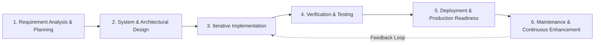
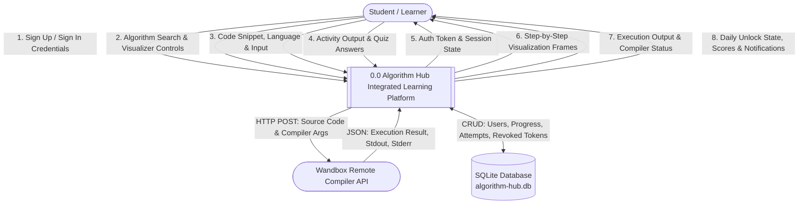
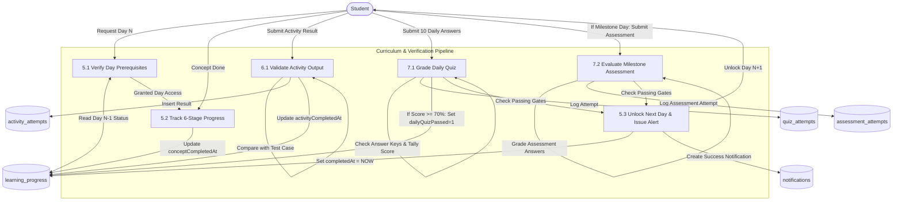
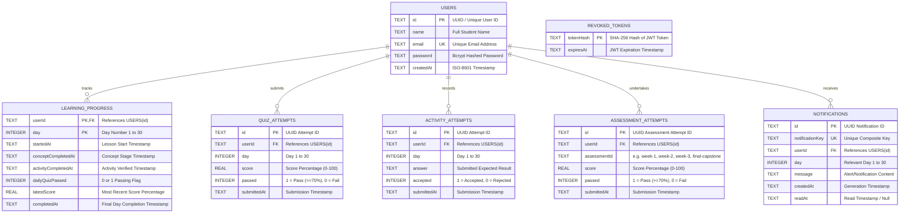
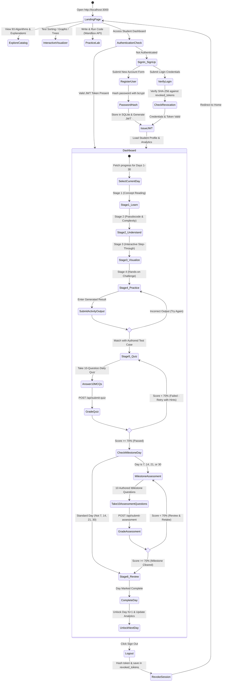
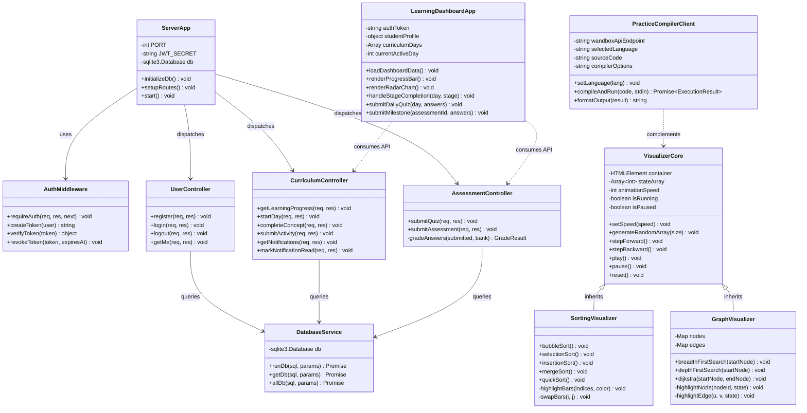
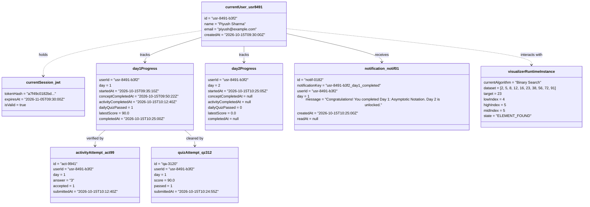
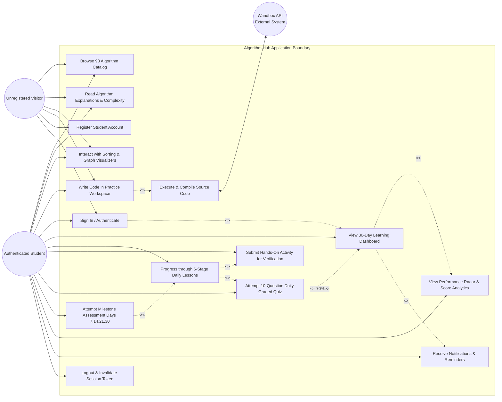

# Algorithm Hub — Software Engineering Documentation & Project Diagrams

---

## 3.6 Detailed Project Life Cycle (SDLC)

The development of **Algorithm Hub** follows the **Iterative and Incremental Agile Software Development Life Cycle (SDLC)** model. This methodology was chosen over the traditional Waterfall model due to the multi-faceted nature of the application—combining algorithmic visualization engines, real-time code compilation interfaces, and an authenticated sequential 30-day learning management system.

### Phase Breakdown

| Phase | Key Activities & Objectives | Algorithm Hub Deliverables |
| :--- | :--- | :--- |
| **1. Requirements Analysis & Feasibility Study** | - Identification of end-user pain points in computer science education. - Elicitation of functional and non-functional requirements. - Analysis of technical stack feasibility (Vite, Vanilla JS, Express, SQLite, Wandbox API). | - Software Requirement Specification (SRS). - High-level curriculum syllabus (30 days, 6 stages per day). - Algorithm catalog taxonomy (93 algorithms across 12 categories). |
| **2. Architectural & Detailed System Design** | - Database schema modeling (relational integrity, cascades, indexing). - RESTful API specification and JWT security protocols. - Visualizer Canvas/DOM rendering pipeline and animation state machines. | - System Architecture & Component Diagrams. - Data Flow Diagrams (DFD Level 0, 1, 2). - Entity Relationship Diagram (ERD). - Detailed UML Class and Sequence specifications. |
| **3. Iterative Implementation (Sprints)** | - **Sprint 1**: Core Algorithm catalog (93 entries) & Markdown explanation rendering. - **Sprint 2**: Interactive visualizers (Sorting, Searching, Trees, Graphs). - **Sprint 3**: Practice Lab & multi-language online compiler integration. - **Sprint 4**: Express backend, SQLite persistence, JWT authentication, and 30-day roadmap engine. - **Sprint 5**: Comprehensive 300-question quiz bank and milestone assessments. | - Vite frontend modular bundle. - REST API micro-service backend. - Seeded curriculum and quiz banks (`curriculum.js`, `quiz-bank.js`). |
| **4. Verification & Quality Assurance (Testing)** | - Automated unit and integration testing via Node.js test runner. - Curriculum integrity audits (checking question bank IDs, hints, explanations). - Security auditing (bcrypt hashing, JWT revocation list, CORS validation). - Cross-browser smoke testing and responsive viewport validation (375px to 4K). | - Node.js integration test suite (`npm test`). - Catalog complexity validation report. - Verified token lifecycle and isolation tests. |
| **5. Packaging & Deployment** | - Frontend optimization via Vite production build (`npm run build`). - Environment configuration (`JWT_SECRET`, `FRONTEND_ORIGINS`, `DB_PATH`). - Automated one-click execution scripting (`START-ALGORITHM-HUB.bat`). | - Optimized `dist/` bundle. - Automated execution scripts for local and network testing. |
| **6. Maintenance & Evolution** | - Defect tracking and complexity edge-case resolution. - Expansion of structured algorithmic complexity analysis. - Scalability improvements for cloud hosting (e.g., PostgreSQL migration, Docker containerization). | - Ongoing version patches, audit logs, and maintenance roadmap. |

---

## 3.7 Software Engineering Diagrams

---

### 3.7.1 Data Flow Diagrams (DFD)

#### 1. DFD Level 0 (Context Diagram)
The Context Diagram establishes the boundary of the Algorithm Hub application, highlighting interactions between external entities (Student/User, External Wandbox Compiler API) and the central system.

---

#### 2. DFD Level 1 (Subsystem Deconstruction)
Level 1 decomposes the central system into its major functional modules and displays the internal data stores.

```mermaid
flowchart TD
    User([Student / Learner])
    Compiler([Wandbox Remote Compiler API])

    D1[(D1: Users Store)]
    D2[(D2: Learning Progress Store)]
    D3[(D3: Quiz & Assessment Attempts)]
    D4[(D4: Activity Attempts)]
    D5[(D5: Revoked Tokens)]
    D6[(D6: Notifications)]
    D7[(D7: Algorithm Knowledge Base)]

    User -->|Credentials| P1[1.0 Authentication & Session Controller]
    P1 -->|Store User / Verify Hash| D1
    P1 -->|Check / Invalidate Token| D5
    P1 -->|Issue JWT Token| User

    User -->|Query / Select Category| P2[2.0 Algorithm Catalog & Explanation Engine]
    P2 <-->|Fetch Content & Complexities| D7
    P2 -->|Formatted Explanation & Code| User

    User -->|Speed, Array Size, Step Controls| P3[3.0 Interactive Visualizer Engine]
    P3 -->|Render DOM/SVG State Transitions| User

    User -->|Source Code & Lang| P4[4.0 Practice Lab & Compiler Relay]
    P4 -->|Payload| Compiler
    Compiler -->|StdOut / Errors| P4
    P4 -->|Execution Console Output| User

    User -->|Start Day / Progress Concept| P5[5.0 30-Day Learning Path Controller]
    P5 <-->|Read / Write Status & Unlocks| D2
    P5 -->|Generate Reminders| D6
    D6 -->|Persistent Alerts| User

    User -->|Submit Activity Output| P6[6.0 Activity Validator]
    P6 -->|Check against Server Test Case| P6
    P6 -->|Record Activity Record| D4
    P6 -->|Unlock Quiz Stage| D2

    User -->|Submit 10-Question Answers| P7[7.0 Quiz & Assessment Grader]
    P7 -->|Compute Score & Passing Criteria| P7
    P7 -->|Record Attempt Score| D3
    P7 -->|Update Daily/Milestone Passed Status| D2
    P7 -->|Result Feedback & Explanations| User
```

---

#### 3. DFD Level 2 (Curriculum & Evaluation Pipeline)
Focuses specifically on the progression engine (Processes 5.0, 6.0, and 7.0).

---

### 3.7.2 Entity Relationship Diagram (ERD)

The relational schema is implemented in SQLite with foreign key enforcement and cascading deletion.

---

### 3.7.3 Activity Diagram

This diagram maps the learner journey across the Algorithm Hub platform, illustrating authentication, visual exploration, practice, and the strict sequential requirements of the 30-day curriculum.

---

### 3.7.4 Class Diagram

The UML Class Diagram models both backend architectural controllers/services and frontend component modules.

---

### 3.7.5 Object Diagram

This diagram displays a concrete runtime snapshot of system objects during an active student session on Day 1.

---

### 3.7.6 Use Case Diagram

The Use Case Diagram defines the interactions between actors (Unregistered Visitor, Authenticated Student, Remote Compiler API) and the platform's core functional capabilities.

---

## Summary of Diagram Types Provided

| Diagram Reference | Notation Standard | Primary Engineering Purpose |
| :--- | :--- | :--- |
| **3.6 SDLC** | Agile Flow Diagram | Details the 6-phase iterative development and QA methodology. |
| **3.7.1 DFD (0, 1, 2)** | Yourdon & Coad / Gane & Sarson | Traces data inputs, processes, data stores, and outputs across levels. |
| **3.7.2 ERD** | Crow's Foot Relational Notation | Represents SQLite tables, PK/FK relationships, and cascade actions. |
| **3.7.3 Activity Diagram** | UML 2.5 Activity / State Machine | Maps user decision diamonds, stage gating, and milestone checks. |
| **3.7.4 Class Diagram** | UML 2.5 Class Model | Defines modular object-oriented classes, controllers, and services. |
| **3.7.5 Object Diagram** | UML 2.5 Instance Snapshot | Shows actual runtime instances, token hashes, and Day 1 attempt data. |
| **3.7.6 Use Case Diagram** | UML 2.5 Use Case Specification | Illustrates user actors, system boundaries, includes, and extends. |
