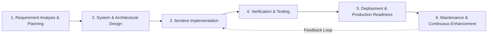
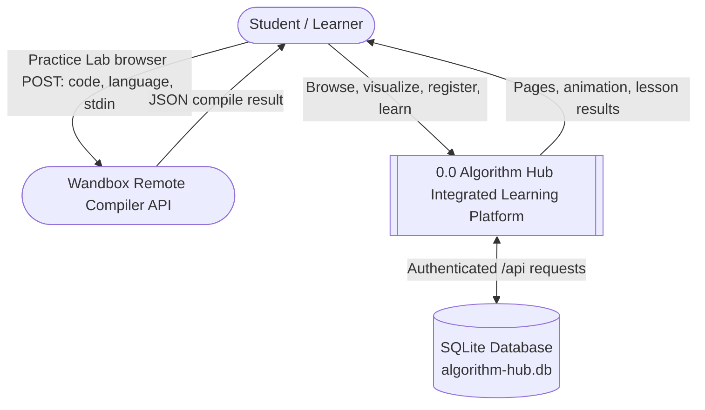
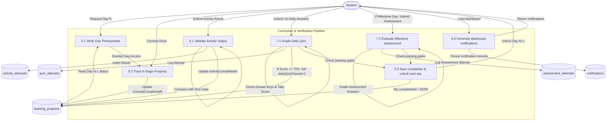
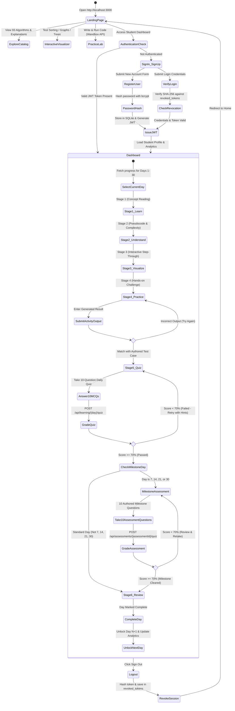
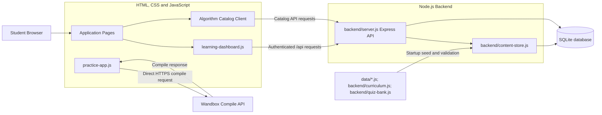
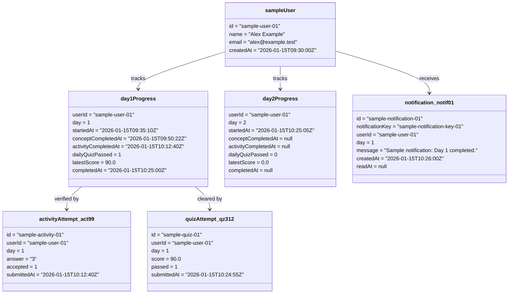
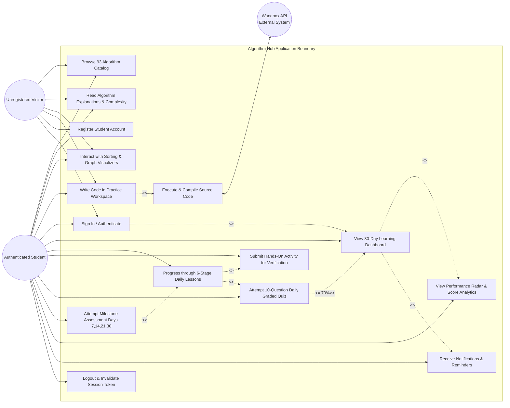

# Algorithm Hub — Software Engineering Documentation & Project Diagrams

---

## 3.6 Detailed Project Life Cycle (SDLC)

The development of **Algorithm Hub** follows the **Iterative and Incremental Agile Software Development Life Cycle (SDLC)** model. This methodology was chosen over the traditional Waterfall model due to the multi-faceted nature of the application—combining algorithmic visualization engines, real-time code compilation interfaces, and an authenticated sequential 30-day learning management system.

### Phase Breakdown

| Phase | Key Activities & Objectives | Algorithm Hub Deliverables |
| :--- | :--- | :--- |
| **1. Requirements Analysis & Feasibility Study** | - Define the catalog, learning curriculum, account, and progress requirements. - Select the browser, Express, SQLite, and Wandbox integration stack. | - Project setup instructions and implemented catalog/curriculum scope. |
| **2. Architectural & Detailed System Design** | - SQLite schema and API design. - Frontend visualization and animation behavior. - JWT authentication and account-scoped data access. | - Architecture, data-flow, ER, activity, component, object, and use-case diagrams included in this documentation. |
| **3. Iterative Implementation** | - Algorithm catalog and explanation pages. - Sorting, searching, tree, and graph visualizers. - Browser-based Practice Lab, Express API, SQLite persistence, and 30-day curriculum. | - Vite frontend, Express API, database-backed catalog and learning content. |
| **4. Verification & Quality Assurance** | - Node.js automated tests for catalog complexity metadata, content migration, API reads, authentication, and learning progression. - JavaScript syntax checks and Vite production build. | - Automated test suite and build checks. Manual browser/device and live Wandbox checks were not run in this review. |
| **5. Packaging & Local Startup** | - Vite production build configuration. - Runtime settings (`JWT_SECRET`, `FRONTEND_ORIGINS`, `DB_PATH`, `PORT`). - Windows startup script. | - Local startup instructions and launcher script; the project is not deployed as a public service. |
| **6. Future Maintenance** | - Potential improvements include broader browser testing and deployment hardening. | - Future work; no production deployment is claimed. |

---

## 3.7 Software Engineering Diagrams

---

### 3.7.1 Data Flow Diagrams (DFD)

#### 1. DFD Level 0 (Context Diagram)
The Context Diagram establishes the boundary of the Algorithm Hub application, highlighting interactions between external entities (Student/User, External Wandbox Compiler API) and the central system.

---

#### 2. DFD Level 1 (Subsystem Deconstruction)
Level 1 decomposes the central system into its major functional modules and displays the internal data stores.

```mermaid
flowchart TD
    User([Student / Learner])
    Compiler([Wandbox Remote Compiler API])

    D1[(D1: Users Store)]
    D2[(D2: Learning Progress Store)]
    D3[(D3: Quiz & Assessment Attempts)]
    D4[(D4: Activity Attempts)]
    D5[(D5: Revoked Tokens)]
    D6[(D6: Notifications)]
    D7[(D7: Algorithm Knowledge Base)]

    User -->|Credentials| P1[1.0 Authentication & Session Controller]
    P1 -->|Store User / Verify Hash| D1
    P1 -->|Check / Invalidate Token| D5
    P1 -->|Issue JWT Token| User

    User -->|Query / Select Category| P2[2.0 Algorithm Catalog & Explanation Engine]
    P2 <-->|Fetch Content & Complexities| D7
    P2 -->|Formatted Explanation & Code| User

    User -->|Speed, Array Size, Step Controls| P3[3.0 Interactive Visualizer Engine]
    P3 -->|Render DOM/SVG State Transitions| User

    User -->|Source code, language & stdin| P4[4.0 Practice Lab in Browser]
    P4 -->|Direct HTTPS POST to Wandbox| Compiler
    Compiler -->|JSON stdout, stderr & status| P4
    P4 -->|Execution output| User

    User -->|Start Day / Progress Concept| P5[5.0 30-Day Learning Path]
    P5 <-->|Read / Write Status & Unlocks| D2

    User -->|Submit Activity Output| P6[6.0 Activity Validator]
    P6 -->|Check against Server Test Case| P6
    P6 -->|Record Activity Record| D4
    P6 -->|Unlock Quiz Stage| D2

    User -->|Submit 10-Question Answers| P7[7.0 Quiz & Assessment Grader]
    P7 -->|Compute Score & Passing Criteria| P7
    P7 -->|Record Attempt Score| D3
    P7 -->|Update Daily/Milestone Passed Status| D2
    P7 -->|Result Feedback & Explanations| User

    User -->|Load dashboard| P8[8.0 Dashboard & Notifications]
    P8 <-->|Read / Persist Notifications| D6
    P8 -->|Dashboard and notifications| User
```

---

#### 3. DFD Level 2 (Curriculum & Evaluation Pipeline)
Focuses specifically on the progression engine (Processes 5.0, 6.0, and 7.0).

---

### 3.7.2 Entity Relationship Diagram (ERD)

The runtime content and user-data schema is implemented in SQLite with foreign key enforcement and cascading deletion. On startup, backend seed sources are validated and transactionally upserted; API reads use the database tables.

```mermaid
erDiagram
    USERS ||--o{ LEARNING_PROGRESS : tracks
    USERS ||--o{ QUIZ_ATTEMPTS : submits
    USERS ||--o{ ACTIVITY_ATTEMPTS : records
    USERS ||--o{ ASSESSMENT_ATTEMPTS : undertakes
    USERS ||--o{ NOTIFICATIONS : receives
    LESSONS ||--o{ QUIZZES : contains
    QUIZZES ||--o{ QUIZ_QUESTIONS : contains

    ALGORITHMS {
        TEXT slug PK "Unique Algorithm Slug"
        TEXT categoryKey "Catalog Category Key"
        TEXT categoryLabel "Catalog Category Label"
        INTEGER position "Order Within Category"
        TEXT name "Algorithm Name"
        TEXT description "Card Description"
        TEXT timeComplexity "Time Complexity"
        TEXT auxiliarySpace "Auxiliary Space"
    }

    LESSONS {
        INTEGER day PK "Day Number 1 to 30"
        TEXT title "Lesson Title"
        TEXT level "Difficulty Level"
        INTEGER minutes "Estimated Minutes"
        TEXT objectivesJson "Lesson Objectives"
        TEXT explanation "Lesson Explanation"
        TEXT exampleJson "Example Input and Output"
        TEXT steps "Guided Steps"
        TEXT activity "Practical Activity"
        TEXT activityInput "Activity Input"
        TEXT activityHint "Activity Hint"
        TEXT activityExpectedAnswer "Server-side Expected Result"
        TEXT linksJson "Lesson Resource Links"
    }

    QUIZZES {
        TEXT id PK "Daily Quiz or Assessment ID"
        TEXT type "daily or assessment"
        INTEGER day FK "Lesson or Milestone Day"
        TEXT title "Quiz Title"
        TEXT daysJson "Days Covered by Assessment"
    }

    QUIZ_QUESTIONS {
        TEXT quizId PK, FK "References QUIZZES(id)"
        TEXT id PK "Question ID"
        INTEGER position "Question Order"
        TEXT prompt "Question Text"
        TEXT optionsJson "Answer Choices"
        INTEGER answerIndex "Server-side Correct Option"
        TEXT hint "Question Hint"
        TEXT explanation "Answer Explanation"
    }

    USERS {
        TEXT id PK "UUID / Unique User ID"
        TEXT name "Full Student Name"
        TEXT email UK "Unique Email; no verification workflow"
        TEXT password "Bcrypt Hashed Password"
        TEXT createdAt "ISO-8601 Timestamp"
    }

    LEARNING_PROGRESS {
        TEXT userId PK, FK "References USERS(id)"
        INTEGER day PK "Day Number 1 to 30"
        TEXT startedAt "Lesson Start Timestamp"
        TEXT conceptCompletedAt "Concept Stage Timestamp"
        TEXT activityCompletedAt "Activity Verified Timestamp"
        INTEGER dailyQuizPassed "0 or 1 Passing Flag"
        REAL latestScore "Most Recent Score Percentage"
        TEXT completedAt "Final Day Completion Timestamp"
    }

    QUIZ_ATTEMPTS {
        TEXT id PK "UUID Attempt ID"
        TEXT userId FK "References USERS(id)"
        INTEGER day "Day 1 to 30"
        REAL score "Score Percentage (0-100)"
        INTEGER passed "1 = Pass (>=70%), 0 = Fail"
        TEXT submittedAt "Submission Timestamp"
    }

    ACTIVITY_ATTEMPTS {
        TEXT id PK "UUID Attempt ID"
        TEXT userId FK "References USERS(id)"
        INTEGER day "Day 1 to 30"
        TEXT answer "Submitted Expected Result"
        INTEGER accepted "1 = Accepted, 0 = Rejected"
        TEXT submittedAt "Submission Timestamp"
    }

    ASSESSMENT_ATTEMPTS {
        TEXT id PK "UUID Assessment Attempt ID"
        TEXT userId FK "References USERS(id)"
        TEXT assessmentId "Assessment identifier"
        REAL score "Score Percentage (0-100)"
        INTEGER passed "1 = Pass (>=70%), 0 = Fail"
        TEXT submittedAt "Submission Timestamp"
    }

    NOTIFICATIONS {
        TEXT id PK "UUID Notification ID"
        TEXT notificationKey UK "Unique Composite Key"
        TEXT userId FK "References USERS(id)"
        INTEGER day "Relevant Day 1 to 30"
        TEXT message "Alert/Notification Content"
        TEXT createdAt "Generation Timestamp"
        TEXT readAt "Read Timestamp / Null"
    }

    REVOKED_TOKENS {
        TEXT tokenHash PK "SHA-256 Hash of JWT Token"
        TEXT expiresAt "JWT Expiration Timestamp"
    }
```

---

### 3.7.3 Activity Diagram

This diagram maps the learner journey across the Algorithm Hub platform, illustrating authentication, visual exploration, practice, and the strict sequential requirements of the 30-day curriculum.

---

### 3.7.4 Component Diagram

The implementation uses a multi-page browser frontend, one Express server module, and a SQLite database; the backend does not contain separate controller classes.

---

### 3.7.5 Object Diagram

This diagram is an illustrative sample of persisted application data, not a capture of a real student account or runtime session.

---

### 3.7.6 Use Case Diagram

The Use Case Diagram defines the interactions between actors (Unregistered Visitor, Authenticated Student, Remote Compiler API) and the platform's core functional capabilities.

---

## Summary of Diagram Types Provided

| Diagram Reference | Notation Standard | Primary Engineering Purpose |
| :--- | :--- | :--- |
| **3.6 SDLC** | Agile Flow Diagram | Details the 6-phase iterative development and QA methodology. |
| **3.7.1 DFD (0, 1, 2)** | Yourdon & Coad / Gane & Sarson | Traces data inputs, processes, data stores, and outputs across levels; Practice Lab calls Wandbox directly from the browser. |
| **3.7.2 ERD** | Crow's Foot Relational Notation | Represents SQLite tables, PK/FK relationships, and cascade actions. |
| **3.7.3 Activity Diagram** | UML 2.5 Activity / State Machine | Maps user decision diamonds, stage gating, and milestone checks. |
| **3.7.4 Component Diagram** | Component / data-flow view | Shows the implemented browser, Express API, content store, SQLite, and direct Wandbox connection. |
| **3.7.5 Object Diagram** | UML 2.5 Instance Snapshot | Shows fictional sample account and Day 1 records; it is not actual runtime data. |
| **3.7.6 Use Case Diagram** | UML 2.5 Use Case Specification | Illustrates user actors, system boundaries, includes, and extends. |
